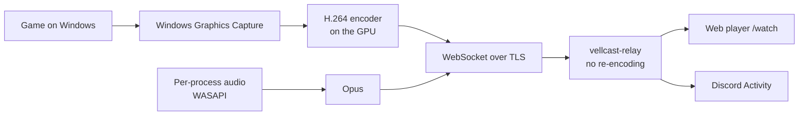

<h1 align="center">Vellcast</h1>

A **lightweight screen sharer made for games**: stream your Windows game in **1080p60 for free**, with the game's audio, and watch it in the browser (or inside Discord) without installing anything on the viewer's side. Written in **Rust with Slint**: no Electron, no bundled browser engine, no web view. Open source (AGPL-3.0-only), **no telemetry**, and you can run your own server.

🇧🇷 [Leia em português](README.pt-BR.md)


> **Alpha.** The whole path (capture → encoder → server → viewers) works and is tested end to end on a real Windows machine in CI, but it has **not been validated with real GPUs and games or with physical controllers yet**. See the [roadmap](ROADMAP.md) (Portuguese).

<p align="center">
  
</p>

## Screenshots

The interface is available in Portuguese and English; these are real captures of the app, rendered by the project's CI on Windows.

| | |
|---|---|
|  |  |
|  |  |

## Download

Get the **[latest release](https://github.com/nextestudios/Vellcast/releases/latest)**:

- **`Vellcast-Setup-x64.exe`** (recommended): per-user install, no admin; checks for **verified, signed updates** when you ask (About → Check for updates).
- **`Vellcast-Portable-x64.exe`**: a single executable that keeps its data in the `Vellcast_Data` folder next to it; it tells you about new versions, replacing it is manual.

Windows 10 2004+ or Windows 11, x64. A GPU with a video encoder (NVIDIA, AMD or Intel) is recommended. Not code-signed yet, so SmartScreen may warn ([policy](docs/CODE_SIGNING.md)).

**First stream:** Rooms → Create room → Generate invite link → Copy. Then Stream: pick the game, window or monitor, the quality and the room → Start. Whoever gets the link opens it in Chrome or Edge, on any device, and clicks **Enable audio**. The app comes set up with the test server `https://vellcast.nextestudios.com`; to use your own, see [Self-hosting](#self-hosting).

## Light on your PC

Vellcast is a native app meant to sit next to a game. Measured on Windows, Release build ([methodology and all results](docs/PERFORMANCE.md), Portuguese):

| Scenario | Result |
|---|---|
| Desktop app idle (window open) | 0.16–0.47% of one core · 36 MB |
| Desktop app in the tray | 0.16% of one core · 27.5 MB |
| Audio/video sync at the transport | 9–12 ms |
| Adaptive bitrate with upload limited to 300 kbps | 3000 → 500 kbps, no lost frames |
| Competitive mode with the CPU overloaded | 60 → 24 FPS target, keeping the game first |
| 60-minute session | no memory growth |
| Server: 50 viewers at 1080p60 for 60 min | 187 GB delivered · 0 drops · ≤ 14 MB of RAM |

- The encoder runs on the GPU (NVENC, AMD AMF, Intel Quick Sync) through Media Foundation, with the Microsoft software encoder as a fallback; colour conversion runs on the GPU too.
- The server does **not re-encode**: every viewer gets the same encoded bytes, so each extra viewer costs bandwidth, not CPU on your PC.

## How it works



| Component | Path | Technology |
|---|---|---|
| Desktop app | [`apps/desktop`](apps/desktop) | Rust, Slint |
| Capture · Encoder · Audio | [`crates/capture`](crates/capture) · [`crates/encoder`](crates/encoder) · [`crates/audio`](crates/audio) | Windows Graphics Capture, Media Foundation, WASAPI, Opus |
| Streaming engine | [`crates/vellcast-core`](crates/vellcast-core) | Pipeline, adaptive bitrate |
| Controller | [`crates/controller`](crates/controller) | GilRs |
| Protocol · Transport | [`crates/protocol`](crates/protocol) · [`crates/transport`](crates/transport) | Binary WebSocket, TLS (rustls) |
| Server (relay) | [`services/relay`](services/relay) | Tokio, Axum, optional SQLite |
| Web player and Discord Activity | [`apps/discord-activity`](apps/discord-activity) | React, TypeScript, WebCodecs |

Details: [architecture](docs/ARCHITECTURE.md) and [streaming protocol](docs/STREAMING_PROTOCOL.md) (Portuguese).

## Features

**Streaming**
- **Native capture** of a game, window or monitor with Windows Graphics Capture: no injection into game processes, nothing that touches anti-cheat
- **1080p60 free**, hardware H.264 with a software fallback; quality presets (Economy, Balanced, Quality, Competitive) and manual bitrate
- **Game audio only**: per-process capture (WASAPI + Opus) that leaves your Discord voice out
- **Adaptive bitrate** that follows the network, and a **competitive mode** that lowers the FPS before it hurts the game
- **Tray mode**: close the window and keep streaming; advanced metrics on the Live screen

**Watching**
- **Nothing to install**: the viewer opens an invite link in Chrome or Edge (WebCodecs), on a PC or a phone
- **Discord Activity** to watch inside a voice channel (waiting for the Discord application)

**Privacy and safety**
- **Private rooms** with temporary invites and signed tokens, revocable on the server
- **Nothing is recorded**: video and audio only pass through the server's memory on their way to the people you invited
- **Signed updates**: the installer is only run after the Ed25519 manifest signature and the SHA-256 match

**Controller first**
- The **whole app works with a gamepad** (Xbox, PlayStation, generic), with its own **on-screen keyboard**
- Keyboard and mouse work everywhere too

## Self-hosting

The relay is a single binary or container with no external dependencies:

```bash
docker build -f infrastructure/docker/relay.Dockerfile -t vellcast-relay .
docker run -d -p 8788:8788 \
  -e VELLCAST_RELAY_SECRET=$(openssl rand -hex 32) \
  -e VELLCAST_DB_PATH=/data/relay.db -v vellcast-relay:/data \
  vellcast-relay
```

Put it behind an HTTPS proxy (browsers need HTTPS to play the video) and set its address in **Settings → Server** in the app. Full guide, including Dokploy: [`docs/DEPLOYMENT.md`](docs/DEPLOYMENT.md) (Portuguese).

## Building from source

Requires stable Rust (1.88+), Node 22+, and on Windows the MSVC Build Tools and CMake.

```bash
cargo fmt --all -- --check
cargo clippy --workspace --all-targets -- -D warnings
cargo test --workspace

# Desktop app (Windows)
cargo run --release -p vellcast-desktop

# Relay + web player
(cd apps/discord-activity && npm ci && npm run build)
VELLCAST_RELAY_INSECURE_DEV=1 cargo run --release -p vellcast-relay
```

We follow Gitflow: CI builds and tests every pull request on Linux and Windows; a `vX.Y.Z` tag on `main` builds, tests, launches and publishes the release. See [CONTRIBUTING.md](CONTRIBUTING.md) (Portuguese).

## Roadmap

**Next:** validation with real GPUs, games and controllers, the Discord Activity, a server in Brazil and code signing. Details in [ROADMAP.md](ROADMAP.md) (Portuguese, MoSCoW priorities).

## Code signing policy

Releases are **not code-signed yet**, so Windows SmartScreen may warn on first run.

- **Committers and reviewers:** [@nextestudios](https://github.com/nextestudios) (maintainer; every change goes through a pull request and CI)
- **Approvers:** [@nextestudios](https://github.com/nextestudios) (each release is approved by the maintainer)
- **Build:** releases are built only by the public [release workflow](.github/workflows/release.yml) on GitHub Actions from a tag on `main`; signing keys are never stored in this repository.
- **Privacy:** this program will not transfer any information to other networked systems unless specifically requested by the user or the person installing or operating it. Vellcast only talks to the streaming server you choose (Settings → Server; by default the project's test server) while you use rooms or stream, and to GitHub when you check for updates ([privacy policy](docs/PRIVACY.md)).

Details: [docs/CODE_SIGNING.md](docs/CODE_SIGNING.md).

## More

- **Feedback:** [this form](https://github.com/nextestudios/Vellcast/issues/new?template=feedback.yml)
- Testing on Windows: [docs/TESTING_WINDOWS.md](docs/TESTING_WINDOWS.md) (Portuguese)
- Changelog: [English](CHANGELOG.en-US.md) · [português](CHANGELOG.md)

[GNU Affero General Public License v3.0 only](LICENSE) ([licensing notes](docs/LICENSING.md)) · [Code signing policy](docs/CODE_SIGNING.md) · [Privacy](docs/PRIVACY.md) · [Security](SECURITY.md)
