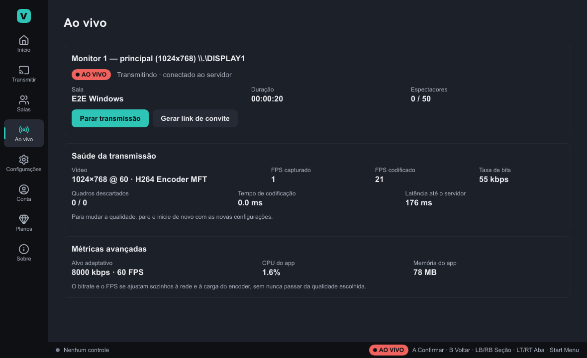
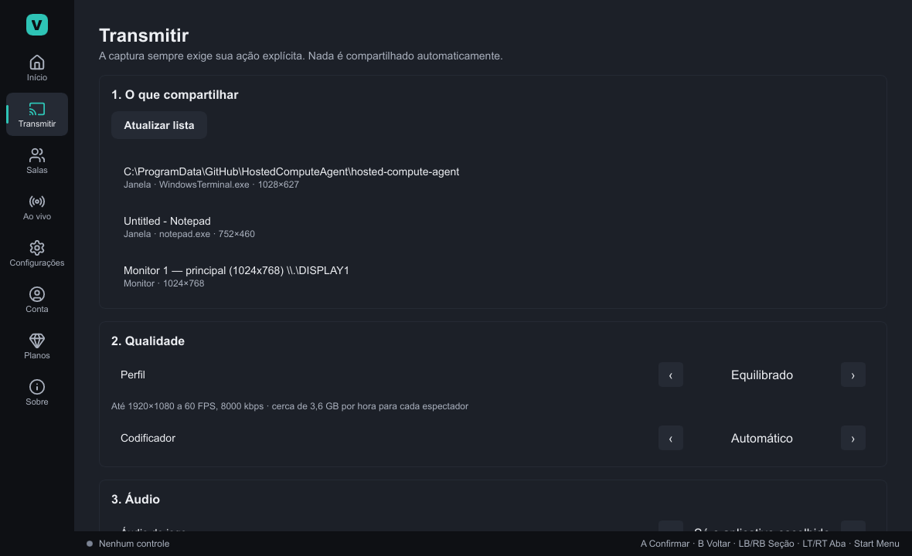
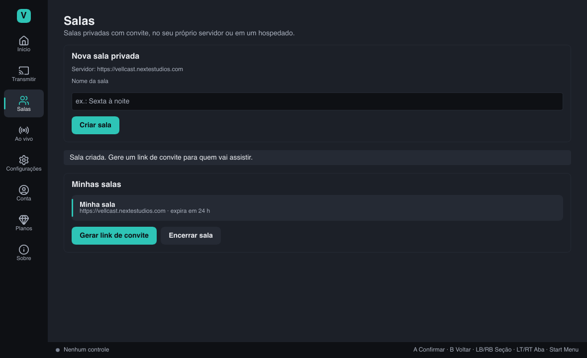
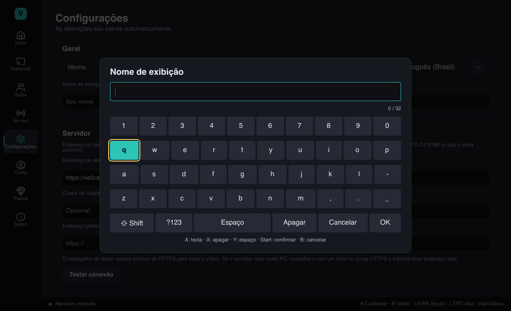
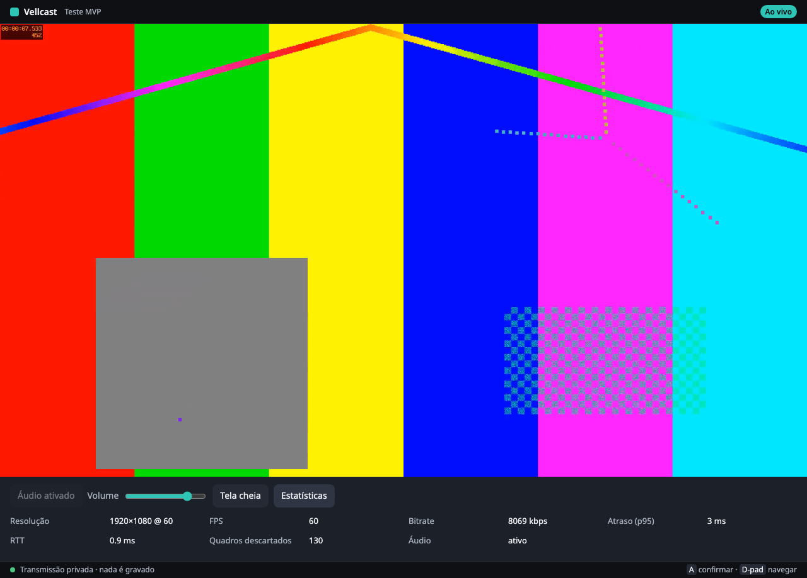
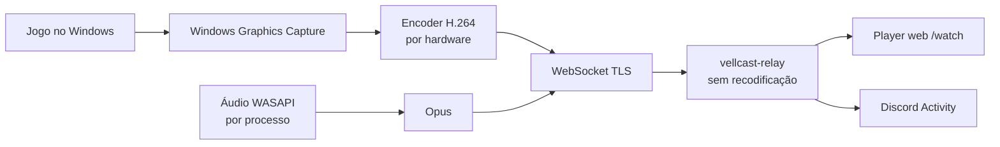

<div align="center">

# Vellcast

**Compartilhamento de tela para jogos — leve, em 1080p60 grátis, com áudio e controle.**

Transmita seu jogo do Windows em segundos e assista no navegador ou dentro do Discord, sem instalar nada do lado de quem assiste.

[](https://github.com/nextestudios/Vellcast/actions/workflows/ci.yml)
[](https://github.com/nextestudios/Vellcast/actions/workflows/windows-e2e.yml)
[](https://github.com/nextestudios/Vellcast/releases/latest)


[**Baixar para Windows**](https://github.com/nextestudios/Vellcast/releases/latest) ·
[Guia de testes](docs/TESTING_WINDOWS.md) ·
[Roadmap](ROADMAP.md) ·
[Arquitetura](docs/ARCHITECTURE.md)



</div>

---

## ✨ Recursos

- 🎮 **Feito para jogos** — captura nativa via Windows Graphics Capture, sem injeção em processos e sem interferir no anti-cheat.
- ⚡ **Leve de verdade** — app nativo em Rust + Slint, sem Electron: **0,5% de CPU e 36 MB** parado, medido no Windows.
- 🖥️ **1080p60 grátis** — encoder por hardware (NVIDIA NVENC, AMD, Intel Quick Sync) com fallback por software.
- 🔊 **Áudio do jogo** — captura só o áudio do jogo escolhido (WASAPI por processo), sem pegar a voz do Discord.
- 🕹️ **Controle em primeiro lugar** — todo o app navegável por gamepad, com teclado virtual.
- 📉 **Bitrate adaptativo** — a qualidade se ajusta sozinha à rede; o **modo competitivo** reduz o FPS para preservar o jogo.
- 👀 **Quem assiste não instala nada** — player no navegador por link de convite, ou dentro de uma Discord Activity.
- 🔒 **Privado por padrão** — salas privadas, convites temporários, tokens assinados; nada é gravado.
- 🏠 **Servidor próprio** — o relay roda em qualquer VPS com Docker; transmita sem depender da nossa nuvem.

## 📸 Capturas

| Transmitir | Salas e convites |
|---|---|
|  |  |
| **Teclado virtual (controle)** | **Player no navegador** |
|  |  |

## 🚀 Começando

### Instalar

1. Baixe o **`Vellcast-Setup-x64.exe`** na [página de releases](https://github.com/nextestudios/Vellcast/releases/latest).
2. Execute o instalador. O Windows SmartScreen pode avisar (o executável ainda não é assinado): **Mais informações → Executar assim mesmo**.
3. Abra o **Vellcast** pelo menu Iniciar.

> Requisitos: Windows 10 2004+ ou Windows 11. Recomendado: GPU com encoder de vídeo (NVIDIA, AMD ou Intel).

### Transmitir

1. **Salas → Criar sala → Gerar link de convite → Copiar**.
2. **Transmitir**: escolha o jogo, janela ou monitor, a qualidade e a sala → **Iniciar transmissão**.
3. Envie o link: quem recebe abre no Chrome ou Edge, em qualquer aparelho, e clica em **Ativar áudio**.

O app já vem configurado com o servidor de testes `https://vellcast.nextestudios.com`. Para usar o seu próprio servidor, veja [Self-hosting](#-self-hosting).

## 🏗️ Arquitetura



Uma única transmissão codificada sobe para o relay, que distribui os mesmos bytes a todos os espectadores autorizados — sem recodificar e sem custo extra de CPU por espectador. Detalhes em [`docs/ARCHITECTURE.md`](docs/ARCHITECTURE.md) e [`docs/STREAMING_PROTOCOL.md`](docs/STREAMING_PROTOCOL.md).

| Componente | Caminho | Tecnologia |
|---|---|---|
| App desktop | [`apps/desktop`](apps/desktop) | Rust, Slint |
| Captura · Encoder · Áudio | [`crates/capture`](crates/capture) · [`crates/encoder`](crates/encoder) · [`crates/audio`](crates/audio) | Windows Graphics Capture, Media Foundation, WASAPI, Opus |
| Motor de transmissão | [`crates/vellcast-core`](crates/vellcast-core) | Pipeline, bitrate adaptativo |
| Controle | [`crates/controller`](crates/controller) | GilRs |
| Protocolo · Transporte | [`crates/protocol`](crates/protocol) · [`crates/transport`](crates/transport) | WebSocket binário, TLS (rustls) |
| Relay | [`services/relay`](services/relay) | Tokio, Axum, SQLite opcional |
| Player web e Discord Activity | [`apps/discord-activity`](apps/discord-activity) | React, TypeScript, WebCodecs |

## 📊 Desempenho

Medições reais (metodologia completa em [`docs/PERFORMANCE.md`](docs/PERFORMANCE.md)):

| Cenário | Resultado |
|---|---|
| App desktop parado (Windows) | 0,16–0,47% de CPU · 36 MB |
| Relay: 50 espectadores 1080p60 por 60 min | 187 GB entregues · 0 descartes · ≤ 14 MB de RAM |
| Sincronia áudio/vídeo no transporte | 9–12 ms |
| Bitrate adaptativo com banda limitada a 300 kbps | 3000 → 500 kbps, sem perder quadros |
| Sessão de 60 min no Windows | sem vazamento de memória |

## 🏠 Self-hosting

O relay é um único binário/container, sem dependências externas:

```bash
docker build -f infrastructure/docker/relay.Dockerfile -t vellcast-relay .
docker run -d -p 8788:8788 \
  -e VELLCAST_RELAY_SECRET=$(openssl rand -hex 32) \
  -e VELLCAST_DB_PATH=/data/relay.db -v vellcast-relay:/data \
  vellcast-relay
```

Coloque-o atrás de um proxy com HTTPS (o navegador exige HTTPS para tocar o vídeo) e use o endereço em **Configurações → Servidor** no app. Guia completo, incluindo Dokploy: [`docs/DEPLOYMENT.md`](docs/DEPLOYMENT.md).

## 🛠️ Compilando do código-fonte

Requisitos: Rust estável (1.88+), Node 22+, e no Windows o MSVC Build Tools e o CMake.

```bash
# Testes e verificações
cargo fmt --all -- --check
cargo clippy --workspace --all-targets -- -D warnings
cargo test --workspace

# App desktop (Windows)
cargo run --release -p vellcast-desktop

# Relay + player web
(cd apps/discord-activity && npm ci && npm run build)
VELLCAST_RELAY_INSECURE_DEV=1 cargo run --release -p vellcast-relay
```

A CI compila e testa em Linux e Windows, roda um teste de ponta a ponta no Windows (captura → encoder → relay → espectadores) e gera o instalador a cada push.

## 🗺️ Roadmap

O MVP para Windows está completo e validado. Próximos passos: validação dentro do Discord, testes com GPUs e jogos reais, servidor no Brasil e planos pagos. Veja o [roadmap completo](ROADMAP.md).

## 🤝 Contribuindo

Leia o [`CONTRIBUTING.md`](CONTRIBUTING.md) e o [código de conduta](CODE_OF_CONDUCT.md). Para reportar vulnerabilidades, siga a [política de segurança](SECURITY.md).

## 📄 Licença

Software proprietário © 2026 [Next Estúdios](https://nextestudios.com) — todos os direitos reservados. Veja [`LICENSE`](LICENSE). Componentes de terceiros mantêm suas próprias licenças ([`docs/LICENSING.md`](docs/LICENSING.md)).
