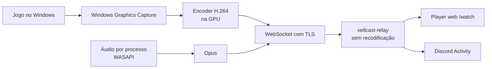

<h1 align="center">Vellcast</h1>

Um **compartilhador de tela leve, feito para jogos**: transmita seu jogo do Windows em **1080p60 de graça**, com o áudio do jogo, e assista no navegador (ou dentro do Discord) sem instalar nada do lado de quem assiste. Escrito em **Rust com Slint**: sem Electron, sem motor de navegador embutido, sem web view. Código aberto (AGPL-3.0-only), **sem telemetria**, e você pode rodar o seu próprio servidor.

🇺🇸 [Read in English](README.md)


> **Alpha.** O caminho inteiro (captura → encoder → servidor → espectadores) funciona e é testado de ponta a ponta num Windows real na CI, mas **ainda não foi validado com GPUs e jogos reais nem com controles físicos**. Veja o [roadmap](ROADMAP.md).

<p align="center">
  
</p>

## Capturas de tela

A interface está em português e inglês; estas são capturas reais do app, geradas pela CI do projeto no Windows.

| | |
|---|---|
|  |  |
|  |  |

## Download

Baixe a **[última release](https://github.com/nextestudios/Vellcast/releases/latest)**:

- **`Vellcast-Setup-x64.exe`** (recomendado): instala por usuário, sem administrador; procura **atualizações verificadas e assinadas** quando você pede (Sobre → Verificar atualizações).
- **`Vellcast-Portable-x64.exe`**: um único executável que guarda os dados na pasta `Vellcast_Data` ao lado dele; avisa quando há versão nova, a troca do arquivo é manual.

Windows 10 2004+ ou Windows 11, x64. Recomendado: GPU com encoder de vídeo (NVIDIA, AMD ou Intel). Ainda sem assinatura de código, então o SmartScreen pode avisar ([política](docs/CODE_SIGNING.md)).

**Primeira transmissão:** Salas → Criar sala → Gerar link de convite → Copiar. Depois Transmitir: escolha o jogo, janela ou monitor, a qualidade e a sala → Iniciar. Quem recebe o link abre no Chrome ou no Edge, em qualquer aparelho, e clica em **Ativar áudio**. O app já vem configurado com o servidor de testes `https://vellcast.nextestudios.com`; para usar o seu, veja [Servidor próprio](#servidor-próprio).

## Leve no seu PC

O Vellcast é um app nativo, feito para ficar ao lado de um jogo. Medido no Windows, build Release ([metodologia e todos os resultados](docs/PERFORMANCE.md)):

| Cenário | Resultado |
|---|---|
| App desktop parado (janela aberta) | 0,16–0,47% de um núcleo · 36 MB |
| App desktop na bandeja | 0,16% de um núcleo · 27,5 MB |
| Sincronia áudio/vídeo no transporte | 9–12 ms |
| Bitrate adaptativo com subida limitada a 300 kbps | 3000 → 500 kbps, sem perder quadros |
| Modo competitivo com a CPU sobrecarregada | alvo de 60 → 24 FPS, preservando o jogo |
| Sessão de 60 minutos | sem crescimento de memória |
| Servidor: 50 espectadores em 1080p60 por 60 min | 187 GB entregues · 0 descartes · ≤ 14 MB de RAM |

- O encoder roda na GPU (NVENC, AMD AMF, Intel Quick Sync) pelo Media Foundation, com o encoder de software da Microsoft como reserva; a conversão de cores também roda na GPU.
- O servidor **não recodifica**: todo espectador recebe os mesmos bytes codificados, então cada espectador a mais custa banda, não CPU no seu PC.

## Como funciona



| Componente | Caminho | Tecnologia |
|---|---|---|
| App desktop | [`apps/desktop`](apps/desktop) | Rust, Slint |
| Captura · Encoder · Áudio | [`crates/capture`](crates/capture) · [`crates/encoder`](crates/encoder) · [`crates/audio`](crates/audio) | Windows Graphics Capture, Media Foundation, WASAPI, Opus |
| Motor de transmissão | [`crates/vellcast-core`](crates/vellcast-core) | Pipeline, bitrate adaptativo |
| Controle | [`crates/controller`](crates/controller) | GilRs |
| Protocolo · Transporte | [`crates/protocol`](crates/protocol) · [`crates/transport`](crates/transport) | WebSocket binário, TLS (rustls) |
| Servidor (relay) | [`services/relay`](services/relay) | Tokio, Axum, SQLite opcional |
| Player web e Discord Activity | [`apps/discord-activity`](apps/discord-activity) | React, TypeScript, WebCodecs |

Detalhes: [arquitetura](docs/ARCHITECTURE.md) e [protocolo de transmissão](docs/STREAMING_PROTOCOL.md).

## Recursos

**Transmissão**
- **Captura nativa** de jogo, janela ou monitor com o Windows Graphics Capture: sem injeção em processos de jogos, nada que mexa com anti-cheat
- **1080p60 de graça**, H.264 por hardware com reserva por software; perfis de qualidade (Econômico, Equilibrado, Qualidade, Competitivo) e bitrate manual
- **Só o áudio do jogo**: captura por processo (WASAPI + Opus) que deixa a sua voz do Discord de fora
- **Bitrate adaptativo** que acompanha a rede e **modo competitivo** que reduz o FPS antes de prejudicar o jogo
- **Modo bandeja**: feche a janela e continue transmitindo; métricas avançadas na tela Ao vivo

**Para quem assiste**
- **Nada para instalar**: o espectador abre um link de convite no Chrome ou no Edge (WebCodecs), no PC ou no celular
- **Discord Activity** para assistir dentro de um canal de voz (aguardando a aplicação no Discord)

**Privacidade e segurança**
- **Salas privadas** com convites temporários e tokens assinados, revogáveis no servidor
- **Nada é gravado**: vídeo e áudio só passam pela memória do servidor a caminho de quem você convidou
- **Atualizações assinadas**: o instalador só é executado depois que a assinatura Ed25519 do manifesto e o SHA-256 conferem

**Controle em primeiro lugar**
- O **app inteiro funciona com gamepad** (Xbox, PlayStation, genérico), com **teclado virtual** próprio
- Teclado e mouse também funcionam em tudo

## Servidor próprio

O relay é um único binário ou container, sem dependências externas:

```bash
docker build -f infrastructure/docker/relay.Dockerfile -t vellcast-relay .
docker run -d -p 8788:8788 \
  -e VELLCAST_RELAY_SECRET=$(openssl rand -hex 32) \
  -e VELLCAST_DB_PATH=/data/relay.db -v vellcast-relay:/data \
  vellcast-relay
```

Coloque-o atrás de um proxy com HTTPS (o navegador exige HTTPS para tocar o vídeo) e use o endereço em **Configurações → Servidor** no app. Guia completo, incluindo Dokploy: [`docs/DEPLOYMENT.md`](docs/DEPLOYMENT.md).

## Compilando do código-fonte

Requisitos: Rust estável (1.88+), Node 22+ e, no Windows, o MSVC Build Tools e o CMake.

```bash
cargo fmt --all -- --check
cargo clippy --workspace --all-targets -- -D warnings
cargo test --workspace

# App desktop (Windows)
cargo run --release -p vellcast-desktop

# Relay + player web
(cd apps/discord-activity && npm ci && npm run build)
VELLCAST_RELAY_INSECURE_DEV=1 cargo run --release -p vellcast-relay
```

Seguimos Gitflow: a CI compila e testa cada pull request em Linux e Windows; uma tag `vX.Y.Z` na `main` gera, testa, abre o app e publica a release. Veja o [CONTRIBUTING.md](CONTRIBUTING.md).

## Roadmap

**Próximos passos:** validação com GPUs, jogos e controles reais, a Discord Activity, um servidor no Brasil e a assinatura de código. Detalhes no [ROADMAP.md](ROADMAP.md) (prioridades MoSCoW).

## Política de assinatura de código (Code signing policy)

As releases **ainda não têm assinatura de código**, então o SmartScreen do Windows pode avisar na primeira execução.

- **Autores e revisores:** [@nextestudios](https://github.com/nextestudios) (mantenedor; toda mudança passa por pull request e CI)
- **Aprovadores:** [@nextestudios](https://github.com/nextestudios) (cada release é aprovada pelo mantenedor)
- **Build:** as releases são geradas só pelo [workflow de release](.github/workflows/release.yml) público no GitHub Actions, a partir de uma tag na `main`; chaves de assinatura nunca ficam neste repositório.
- **Privacidade:** este programa não transfere nenhuma informação para outros sistemas em rede, a não ser quando pedido pelo usuário ou por quem o instala ou opera. O Vellcast só fala com o servidor de transmissão que você escolher (Configurações → Servidor; por padrão, o servidor de testes do projeto) enquanto você usa salas ou transmite, e com o GitHub quando você procura atualizações ([política de privacidade](docs/PRIVACY.md)).

Detalhes: [docs/CODE_SIGNING.md](docs/CODE_SIGNING.md).

## Mais

- **Feedback:** [este formulário](https://github.com/nextestudios/Vellcast/issues/new?template=feedback.yml)
- Testes no Windows: [docs/TESTING_WINDOWS.md](docs/TESTING_WINDOWS.md)
- Histórico de alterações: [português](CHANGELOG.md) · [English](CHANGELOG.en-US.md)

[GNU Affero General Public License v3.0 only](LICENSE) ([notas de licença](docs/LICENSING.md)) · [Política de assinatura de código](docs/CODE_SIGNING.md) · [Privacidade](docs/PRIVACY.md) · [Segurança](SECURITY.md)
