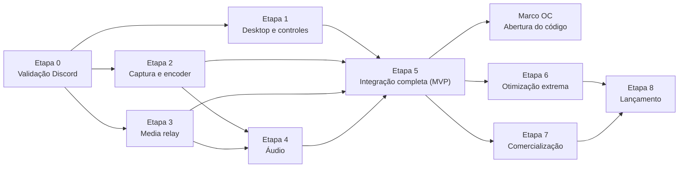

# Vellcast — Roadmap completo

Visão única de tudo o que será feito, da validação inicial ao lançamento, organizada pela metodologia **MoSCoW**.
Critérios de aceite, dependências e notas de cada tarefa estão em [`docs/ROADMAP.md`](docs/ROADMAP.md) (fonte da verdade); a classificação completa dos requisitos está em [`docs/MOSCOW.md`](docs/MOSCOW.md).

Atualizado em: **2026-10-09** (fim do dia)

**Legenda:** ✅ concluído · 🧪 em teste · 🔨 em andamento · ⛔ bloqueado · ⏸️ adiado · ⬜ não iniciado
**MoSCoW:** **M** = Must Have · **S** = Should Have · **C** = Could Have · **W** = Won't Have (fora do MVP)

---

## 1. Visão geral

| Etapa | Nome | Prioridade | Ambiente necessário | Situação |
|---|---|---|---|---|
| 0 | Validação Discord | M | macOS + Discord | ⛔ código pronto (OAuth, pareamento, Activity); falta criar a aplicação no Discord |
| 1 | Desktop e controles | M | macOS (dev) + Windows (validação) | ✅ executada no Windows (CPU 0,16–0,47%, 36 MB); só falta o controle físico (E1-T05) |
| 2 | Captura e encoder | M | **Windows com GPU** | 🧪 executada no Windows real (caminho CPU); caminho GPU e jogos exigem GPU real |
| 3 | Media relay | M | macOS/Linux | ✅ em produção em `vellcast.nextestudios.com`; 60 min estável |
| 4 | Áudio | M | **Windows** | ✅ executada no Windows real; sincronia A/V de 9,2 ms |
| 5 | Integração completa — **MVP** | M | Windows (+ Discord para a Activity) | ✅ MVP Windows: app transmitiu do Windows ao servidor de produção; Activity aguarda E0-T10 |
| OC | Abertura do código (Open Core) | S | — | ✅ concluído: AGPL-3.0-only e repositório público (ADR-060) |
| 6 | Otimização extrema | M | Windows com GPU + jogos | 🧪 software pronto e medido; otimização com GPU real bloqueada |
| 7 | Comercialização | S no MVP / M no Premium | Linux (servidor) | 🧪 backend pronto; cobrança real depende de conta no provedor |
| 8 | Lançamento | M | Windows + produção | 🧪 instalador e atualizador prontos; certificado e revisão jurídica pendentes |

**Marcos:**
1. **MVP** (fim da Etapa 5): um usuário transmite um jogo do Windows e outro assiste dentro do Discord, com controle no desktop.
2. **Núcleo aberto** (Marco OC): repositório público do Vellcast Core.
3. **Lançamento público** (Etapa 8): primeira versão estável com instalador.

---

## 2. Etapas e tarefas

### Etapa 0 — Validação Discord · M
Comprovar que H.264 + Opus via WebSocket e WebCodecs funcionam dentro de uma Discord Activity.

- [x] ✅ E0-T01 — Estrutura do monorepositório
- [x] ✅ E0-T02 — Protocolo binário v1 (`crates/protocol`) com testes
- [x] ✅ E0-T03 — Geração de mídia sintética (720p30 e 1080p60, Opus)
- [x] ✅ E0-T04 — Servidor WebSocket de teste com distribuição para vários espectadores
- [x] ✅ E0-T05 — Activity mínima (superada pela Activity final)
- [x] ✅ E0-T06 — Métricas no player (FPS, descartes, bitrate, latência, A/V skew)
- [x] ✅ E0-T07 — Reconexão automática
- [x] ✅ E0-T08 — Verificação da Gamepad API (no navegador; no Discord junto com E0-T10)
- [x] ✅ E0-T09 — Teste em navegador (local e produção)
- [ ] ⏸️ E0-T10 — Teste em Activity real — aguardando o Client ID/Secret que o responsável vai criar ([guia](docs/DISCORD_INTEGRATION.md))
- [x] ✅ E0-T11 — Relatório de resultados (PERFORMANCE.md)

### Etapa 1 — Desktop e controles · M
Aplicativo Windows leve em Rust + Slint, 100% navegável por controle.

- [x] ✅ E1-T01 — Licença do Slint: Royalty-free 2.0
- [x] ✅ E1-T02 — App desktop (Rust + Slint) executado no Windows
- [x] ✅ E1-T03 — Design system em Slint
- [x] ✅ E1-T04 — Navegação lateral e 8 telas (renderizadas no Windows)
- [ ] ⛔ E1-T05 — Crate `controller` (GilRs) — falta teste com controle físico
- [x] ✅ E1-T06 — Sistema de foco e modais navegáveis
- [x] ✅ E1-T07 — Teclado virtual
- [x] ✅ E1-T08 — Modo bandeja: oculto no Windows, 0,16% de CPU e 27,5 MB
- [x] ✅ E1-T09 — Preparação de i18n (PT-BR e EN, troca em tempo real)
- [x] ✅ E1-T10 — CPU/RAM no Windows: 0,47% de CPU ociosa, 36 MB (metas: <1% e <80 MB)

### Etapa 2 — Captura e encoder · M
Capturar e codificar 1080p60 nativamente, mantendo os quadros na GPU.

- [x] ✅ E2-T01 — Captura de janela (Windows Graphics Capture), executada no Windows
- [x] ✅ E2-T02 — Captura de monitor, executada no Windows
- [x] ✅ E2-T03 — Fallback DXGI: não necessário, o WGC funcionou no Windows real (ADR-057)
- [x] ✅ E2-T04 — Detecção de encoders (hardware primeiro, software como fallback)
- [ ] ⛔ E2-T05 — Caminho GPU (D3D11 → NV12 → H.264 por hardware) — requer Windows com GPU; caminho CPU validado
- [x] ✅ E2-T06 — Configuração de resolução, FPS e bitrate
- [ ] ⛔ E2-T07 — Detecção automática de jogos — validar com jogos reais (S)
- [ ] ⛔ E2-T08 — Medição 1080p60 por GPU — requer máquina Windows
- [x] ✅ E2-T09 — Pipeline do `vellcast-core` executado no Windows (captura → encoder → relay)
- [x] ✅ E2-T10 — Ferramentas de validação manual (`capture_to_file`)

### Etapa 3 — Media relay · M
Servidor `vellcast-relay` que recebe uma transmissão e distribui para vários espectadores, sem recodificar.

- [x] ✅ E3-T01 — `services/relay` (Tokio + Axum)
- [x] ✅ E3-T02 — Crate `transport` (cliente do transmissor, WebSocket TLS)
- [x] ✅ E3-T03 — Salas privadas e autorização com tokens temporários
- [x] ✅ E3-T04 — Filas limitadas por espectador, cache de GOP e pedidos de keyframe
- [x] ✅ E3-T05 — Reconexão com janela de graça
- [x] ✅ E3-T06 — Proteção contra abuso (rate limiting, limites de espectadores e banda)
- [x] ✅ E3-T07 — Docker, docker-compose e guia Dokploy (imagem rodando no Dokploy)
- [x] ✅ E3-T08 — Métricas e health check
- [x] ✅ E3-T09 — Benchmark com 20 espectadores (local: 60 fps, p95 2,2 ms, 4,8% CPU, 9,7 MB)
- [x] ✅ E3-T10 — Deploy em VPS com TLS via Dokploy: `https://vellcast.nextestudios.com` (servidor na Europa limita a vazão para o Brasil)
- [x] ✅ E3-T11 — Salas persistentes em SQLite (em produção, sobrevivem a reinícios) (S)
- [x] ✅ E3-T12 — Revogação de tokens e rotação do segredo sem queda
- [x] ✅ E3-T13 — 60 min com 50 espectadores: 187 GB entregues, zero descartes
- [x] ✅ E3-T14 — Inventário de licenças e duplicatas (`cargo deny` na CI)

### Etapa 4 — Áudio · M
Transmitir o áudio do jogo, sincronizado com o vídeo.

- [x] ✅ E4-T01 — Captura WASAPI por processo (Application Loopback)
- [x] ✅ E4-T02 — Áudio do sistema excluindo o Discord, com aviso ao usuário
- [x] ✅ E4-T03 — Codificação Opus (48 kHz, 20 ms)
- [x] ✅ E4-T04 — Transporte e reprodução
- [x] ✅ E4-T05 — Sincronização A/V: 9,2 ms de diferença no transporte (Windows)

### Etapa 5 — Integração completa (MVP) · M
Desktop, relay e Discord Activity funcionando juntos de ponta a ponta.

- [ ] ⏸️ E5-T01 — OAuth2 do Discord no relay — pronto e testado com Discord simulado; validação real aguarda o app do Discord
- [ ] ⏸️ E5-T02 — Pareamento desktop ↔ Activity — pronto; validação real aguarda o app do Discord
- [x] ✅ E5-T03 — Fluxo de salas na interface (criar, convidar, encerrar)
- [x] ✅ E5-T04 — Iniciar/encerrar transmissão: o app transmitiu do Windows ao servidor de produção
- [ ] ⏸️ E5-T05 — Player final — web em `/watch` validado; Activity aguarda o app do Discord
- [x] ✅ E5-T06 — Perfis de qualidade e atalhos (S)
- [x] ✅ E5-T07 — Tratamento de erros de ponta a ponta
- [x] ✅ E5-T08 — Pacote de teste e instalador Windows, guia [`docs/TESTING_WINDOWS.md`](docs/TESTING_WINDOWS.md)
- [x] ✅ E5-T09 — Player web servido pelo relay (S-011)
- [ ] ⏸️ Validação dentro do Discord (E0-T10) — aguardando o responsável

### Marco OC — Abertura do código (Open Core) · S
Concluído (ADR-060): código aberto sob AGPL-3.0-only em repositório público; a parte comercial fica no repositório privado `nextestudios/vellcast-cloud`.

- [x] ✅ OC-T01 — Licença decidida: AGPL-3.0-only (ADR-060, substitui a ADR-058)
- [x] ✅ OC-T02 — Inventário de licenças de terceiros (`cargo deny` + npm na CI)
- [x] ✅ OC-T03 — Parte comercial separada no repositório privado `nextestudios/vellcast-cloud`, com histórico
- [ ] ⛔ OC-T04 — Verificação da marca "Vellcast" (INPI) — ação sua
- [x] ✅ OC-T05 — Revisão de segurança (sem achados altos ou críticos)
- [x] ✅ OC-T06 — `SECURITY.md` (falta habilitar Private Vulnerability Reporting no GitHub)
- [x] ✅ OC-T07 — Varredura de segredos no histórico e na CI (gitleaks)
- [x] ✅ OC-T08 — Código de conduta e modelos de issue/PR
- [x] ✅ OC-T09 — Repositório público com histórico limpo, num repositório novo (ADR-060)

### Etapa 6 — Otimização extrema · M
Reduzir ao mínimo o impacto da transmissão nos jogos, com números reproduzíveis.

- [x] ✅ E6-T01 — Benchmarks reproduzíveis (`crates/perf`, `tests/benchmarks`, E2E Windows)
- [x] ✅ E6-T02 — Escrita em lote no relay e no transmissor (p99 2,3–3,0 ms → 1,7 ms)
- [ ] ⛔ E6-T03 — Otimização de captura e encoder — requer Windows com GPU real
- [x] ✅ E6-T04 — Ajuste automático de bitrate: validado no Windows com banda limitada (S)
- [x] ✅ E6-T05 — Avaliação QUIC (Quinn) vs WebSocket: medida; QUIC adiado (ADR-037)
- [x] ✅ E6-T06 — Modo competitivo: FPS 60 → 24 com o encoder sobrecarregado no Windows (S)
- [x] ✅ E6-T07 — Métricas avançadas na interface, exibidas no Windows (S)
- [x] ✅ E6-T08 — Testes prolongados: 60 min no Windows real e relay 60 min com 20 e 50 espectadores

### Etapa 7 — Comercialização · S no MVP / M no Premium
Planos Free, Pro e Community sem prejudicar o núcleo gratuito (1080p60 continua grátis).

- [x] ✅ E7-T01 — Políticas do Discord: Premium Apps indisponível no Brasil (venda fora do Discord)
- [x] ✅ E7-T02 — cloud-api (repositório privado `vellcast-cloud`): contas, planos, assinaturas, entitlements e cotas
- [ ] ⏸️ E7-T03 — Pagamentos — pronto em modo de teste; adiado pelo responsável até criar a conta no provedor
- [x] ✅ E7-T04 — Limites aplicados só no relay hospedado (self-hosted sem restrição)
- [x] ✅ E7-T05 — Painel administrativo mínimo (`/admin`)

### Etapa 8 — Lançamento · M
Primeira versão pública estável.

- [x] ✅ E8-T01 — Instalador Windows (Inno Setup), testado na CI; release `v0.1.0` em rascunho (S)
- [ ] ⛔ E8-T02 — Assinatura de código — falta o certificado
- [x] ✅ E8-T03 — Atualizações seguras: manifesto assinado na CI e verificado (adulteração rejeitada) (S)
- [ ] ⏸️ E8-T04 — Termos e privacidade — rascunhos prontos; revisão jurídica adiada pelo responsável
- [ ] ⏸️ E8-T05 — Monitoramento — produção com health check; alertas adiados pelo responsável (webhook do Discord depois)
- [x] ✅ E8-T06 — Localização PT-BR e EN (S)
- [ ] ⏸️ E8-T07 — Testes finais — checklist pronto; execução no PC com GPU adiada pelo responsável

---

## 3. Depois do lançamento — Could Have

Só entram depois que o núcleo estiver estável.

| ID | Item | Observação |
|---|---|---|
| C-001 | Transmissão 1440p60 | Benefício Pro no serviço oficial |
| C-002 | Transmissão 4K60 | Benefício Pro no serviço oficial |
| C-003 | Codec AV1 | Depende de suporte de encoder e decoder |
| C-004 | Codec H.265 | Depende de suporte de decoder nos clientes |
| C-005 | Transmissão a 120 FPS | |
| C-006 | Temas personalizados | |
| C-007 | Salas públicas | Privadas continuam sendo o padrão |
| C-008 | Descoberta de transmissões | |
| C-009 | Gravação local | Nunca automática |
| C-010 | Picture-in-picture | |
| C-011 | Várias transmissões em uma sala | |
| C-012 | Gerenciamento avançado de comunidades | Plano Community |
| C-013 | Dashboard web administrativo | |
| C-014 | Servidores de mídia regionais | |
| C-015 | Aplicativo Linux | |
| C-016 | Aplicativo macOS | |
| C-017 | Player mobile independente | |
| C-018 | Sistema de plugins | Não pode expor APIs do Slint (ADR-006) |
| C-019 | Integrações adicionais | |
| C-020 | Modo P2P opcional fora do Discord | |

## 4. Fora do escopo do MVP — Won't Have

Electron (W-001) · navegador completo embutido no transmissor (W-002) · chat de voz próprio (W-003) · substituir o Discord (W-004) · WebRTC na Activity (W-005) · recodificação obrigatória no servidor (W-006) · captura escondida (W-007) · gravação automática (W-008) · animações pesadas (W-009) · mineração, publicidade invasiva ou processamento oculto (W-010) · injeção em processos de jogos (W-011) · interferência com anti-cheat (W-012) · dependência obrigatória da Vellcast Cloud no self-hosting (W-013) · limitar resolução no código aberto para favorecer planos pagos (W-014) · DRM próprio (W-015) · app multiplataforma no MVP (W-016) · P2P como transporte principal no Discord (W-017).

---

## 5. Pendências que dependem do responsável

Tudo o que podia ser feito e validado sem estas ações está concluído. Em 2026-10-09 o responsável decidiu tratar estes itens depois (⏸️); cada um destrava as tarefas indicadas.

| Pendência | Como fazer | Destrava |
|---|---|---|
| Aplicação no Discord | Seguir [`docs/DISCORD_INTEGRATION.md`](docs/DISCORD_INTEGRATION.md) §4: criar o app, habilitar Activities, URL Mapping `/` → `vellcast.nextestudios.com`, definir `VELLCAST_DISCORD_CLIENT_ID/SECRET` no Dokploy e redeploy | E0-T10, E5-T01, E5-T02, E5-T05 (M-012, M-014, M-015) |
| PC Windows com GPU (NVIDIA, AMD ou Intel) e um jogo | Instalar `Vellcast-Setup-x64.exe` (release `v0.1.0`) e seguir [`docs/TESTING_WINDOWS.md`](docs/TESTING_WINDOWS.md) | E2-T05, E2-T07, E2-T08, E6-T03 |
| Controle físico (Xbox, DualShock 4 ou DualSense) | Navegar pelo app só com o controle (checklist M-003/M-004 do guia) | E1-T05 |
| Certificado de assinatura de código (OV/EV) | Adicionar os segredos `WINDOWS_CERT_PFX_BASE64` e `WINDOWS_CERT_PASSWORD` no GitHub | E8-T02 |
| Conta no provedor de pagamento (Stripe ou Mercado Pago) | Criar conta e chaves de produção; configurar o webhook (DEPLOYMENT §6.11) | E7-T03 (S-015) |
| Revisão jurídica | Revisar `docs/legal/TERMOS.md` e `docs/legal/PRIVACIDADE.md` com os dados da empresa | E8-T04 |
| Alertas de produção | Ativar notificações no Dokploy e um monitor externo ([`docs/OPERATIONS.md`](docs/OPERATIONS.md) §2) | E8-T05 |
| Execução final do checklist | Seguir [`docs/RELEASE_CHECKLIST.md`](docs/RELEASE_CHECKLIST.md) no PC com GPU | E8-T07 |
| Marca "Vellcast" | Busca e registro no INPI | OC-T04 |
| Servidor no Brasil (recomendado) | Contratar VPS em São Paulo e ligar ao Dokploy; ou ativar BBR no VPS atual (DEPLOYMENT §6.10) | Qualidade 1080p60 para espectadores no Brasil |

## 6. Regras do processo

- Nenhuma tarefa é marcada como concluída sem cumprir seus critérios de aceite ([Definição de Pronto](docs/ROADMAP.md#definição-de-pronto)).
- Testes que dependem de hardware, credenciais ou acesso externo indisponível ficam como bloqueados ou pendentes de validação; resultados nunca são inventados.
- Itens Could Have não começam antes dos Must Have necessários.
- Decisões de arquitetura ficam registradas em [`docs/DECISIONS.md`](docs/DECISIONS.md).
